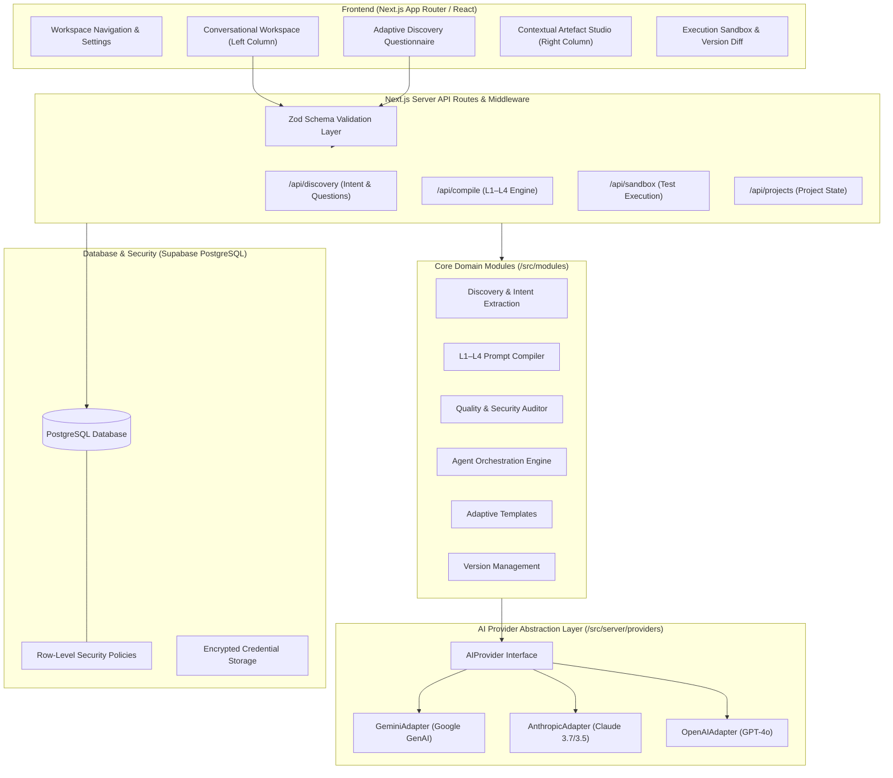

# BIG PROMPTER — ARCHITECTURE DOCUMENTATION v1.0

## 1. Architectural Strategy
BIG PROMPTER adopts a **Modular Monolith** architecture built on **Next.js (App Router)** and **TypeScript (Strict Mode)**. The application maintains clear internal domain service boundaries without introducing premature microservice complexity.



---

## 2. Directory Layout & Module Boundaries
```text
big-prompter/
├── docs/                   # System specifications and manuals
├── src/
│   ├── app/                # Next.js App Router (Layouts, Pages, API endpoints)
│   ├── components/         # Shared UI components (Cinematic Futuristic design)
│   ├── modules/            # Isolated business domain logic
│   │   ├── discovery/      # Intent analysis & dynamic questionnaire
│   │   ├── compiler/       # L1–L4 prompt compiler & syntax formatting
│   │   ├── quality/        # Security, injection defense & structural audits
│   │   ├── providers/      # Multi-model abstraction layer & adapters
│   │   ├── templates/      # Domain templates & metadata
│   │   └── sandbox/        # Isolated test execution container
│   ├── server/             # Server-only services, DB clients & handlers
│   ├── lib/                # Utility helpers (cn, formatting, crypto)
│   ├── types/              # Domain TypeScript types & interfaces
│   └── validation/         # Zod schemas for all runtime payloads
├── supabase/
│   ├── migrations/         # PostgreSQL DDL migrations with RLS
│   └── seed.sql            # Initial starter data & system templates
└── tests/
    ├── unit/               # Fast deterministic unit tests (Vitest)
    └── integration/        # Pipeline & provider contract tests
```

---

## 3. AI Provider Abstraction Interface
All model calls pass through the unified `AIProvider` contract:
```typescript
export interface AIProvider {
  readonly providerId: 'google' | 'anthropic' | 'openai';
  generate(request: GenerationRequest): Promise<GenerationResult>;
  estimateCost(request: GenerationRequest): Promise<CostEstimate>;
  validateConfiguration(): Promise<boolean>;
}
```
* **Normalised Output:** All adapters emit a canonical `GenerationResult` recording raw output text, token counts, latency (ms), and cost estimates.
* **Fallback Guarantee:** When no live API key is supplied, the platform automatically routes to the **Deterministic Engine**, ensuring 100% functionality with zero downtime or external dependencies.
