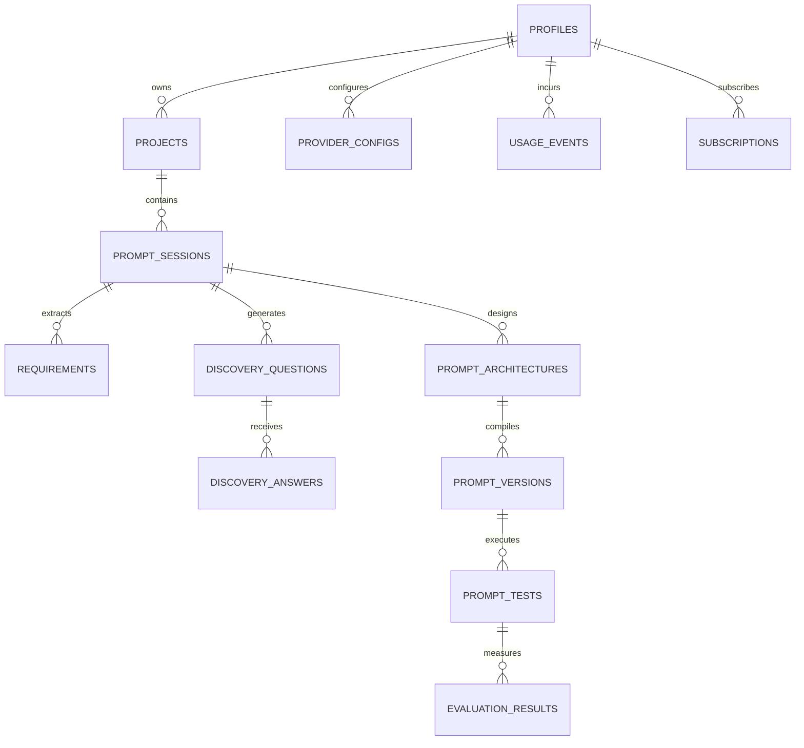

# BIG PROMPTER — DATABASE ARCHITECTURE & SCHEMA SPECIFICATION v1.0

## 1. Relational Entity Overview
BIG PROMPTER uses **Supabase PostgreSQL** with **Row-Level Security (RLS)** to enforce strict project-level and tenant-level isolation.



---

## 2. Core Entities & Attributes (Part 7 Baseline)

1. **`profiles`**: User account record mapped to `auth.users.id`.
   - `id UUID PRIMARY KEY REFERENCES auth.users(id)`
   - `email TEXT NOT NULL`
   - `user_mode TEXT NOT NULL DEFAULT 'professional'`
   - `created_at TIMESTAMPTZ DEFAULT NOW()`

2. **`projects`**: Isolated workspace scope.
   - `id UUID PRIMARY KEY DEFAULT gen_random_uuid()`
   - `user_id UUID NOT NULL REFERENCES profiles(id) ON DELETE CASCADE`
   - `title TEXT NOT NULL`
   - `description TEXT`
   - `is_archived BOOLEAN DEFAULT FALSE`
   - `created_at TIMESTAMPTZ DEFAULT NOW()`

3. **`prompt_sessions`**: Individual prompt engineering cycles.
   - `id UUID PRIMARY KEY DEFAULT gen_random_uuid()`
   - `project_id UUID NOT NULL REFERENCES projects(id) ON DELETE CASCADE`
   - `raw_input TEXT NOT NULL`
   - `domain TEXT NOT NULL`
   - `engineering_level TEXT NOT NULL CHECK (engineering_level IN ('L1', 'L2', 'L3', 'L4'))`
   - `target_model TEXT NOT NULL`
   - `stage TEXT NOT NULL CHECK (stage IN ('input', 'discovery', 'compiled'))`

4. **`discovery_questions` & `discovery_answers`**:
   - Stores dynamic questions synthesized by the discovery engine and selected user options / custom inputs.

5. **`prompt_versions`**:
   - `id UUID PRIMARY KEY DEFAULT gen_random_uuid()`
   - `session_id UUID NOT NULL REFERENCES prompt_sessions(id) ON DELETE CASCADE`
   - `version_number INT NOT NULL`
   - `compiled_prompt TEXT NOT NULL`
   - `components JSONB NOT NULL`
   - `metrics JSONB NOT NULL`
   - `change_summary TEXT`

6. **`prompt_tests` & `evaluation_results`**:
   - Records sandbox runs with test input, actual output, token count, roundtrip latency, and pass/fail assertion status.

7. **`provider_configs`**:
   - Encrypted user API keys (BYOK) with tenant-isolated RLS. Plaintext keys are never stored.

8. **`audit_logs`**:
   - Immutable security and change events.

---

## 3. Row-Level Security (RLS) Policy Blueprint
All tables enable RLS by default:
```sql
ALTER TABLE projects ENABLE ROW LEVEL SECURITY;

CREATE POLICY "Users can only read their own projects"
  ON projects FOR SELECT
  USING (auth.uid() = user_id);

CREATE POLICY "Users can only insert their own projects"
  ON projects FOR INSERT
  WITH CHECK (auth.uid() = user_id);

CREATE POLICY "Users can only update their own projects"
  ON projects FOR UPDATE
  USING (auth.uid() = user_id);

CREATE POLICY "Users can only delete their own projects"
  ON projects FOR DELETE
  USING (auth.uid() = user_id);
```
